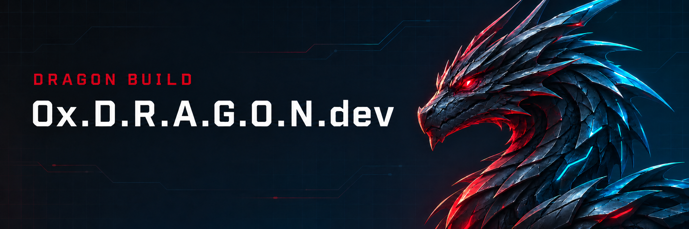
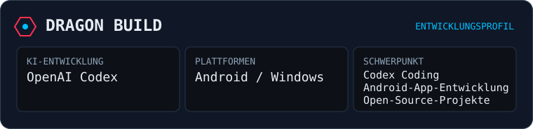

## Developer & Creator

Ich arbeite in der IT-Branche.

Mit OpenAI Codex entwickle ich Android-Apps und Windows-Tools. Meine Schwerpunkte sind Open-Source-Projekte und die Automatisierung von Arbeitsabläufen. Mich interessiert der gesamte Entwicklungsprozess, von der ersten Idee über den Prototyp bis zur Veröffentlichung.

## Tech-Stack

- **OpenAI Codex** für KI-gestützte Softwareentwicklung

## Codex-Projekte

> `Projects initializing...`

<!-- Hier bestätigte öffentliche Repositories mit Kurzbeschreibung und Link ergänzen. -->

**Code. Create. Mod. Automate. Repeat.**
